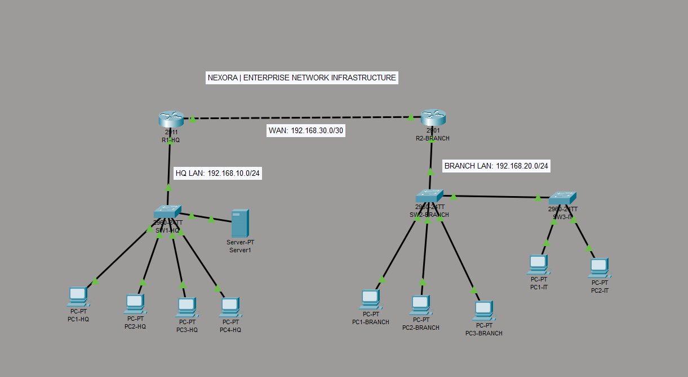

# NEXORA | Enterprise Network Infrastructure

## Project Overview

NEXORA is a simulated enterprise network infrastructure project designed and implemented using Cisco Packet Tracer.

The project connects a company headquarters, a branch office, and an IT support department through a routed network.

### Project Objectives

- Design a multi-office network topology.
- Establish communication between headquarters and branch offices.
- Configure static IP addressing and DHCP.
- Implement DNS and HTTP services.
- Enable inter-network communication using static routing.
- Apply basic network security hardening.
- Test network connectivity and service availability.

## Network Topology

## Network Architecture

NEXORA consists of three operational areas:

- **Headquarters (HQ):** Main office hosting the central server and four workstations.
- **Branch Office:** Remote office containing three workstations.
- **IT Support:** Department containing two workstations, connected to the branch network.

### Network Equipment

| Device | Model | Quantity |
|---|---|---|
| Routers | Cisco 2911 | 2 |
| Switches | Cisco 2960 | 3 |
| Server | Server-PT | 1 |
| Workstations | PC-PT | 9 |

### IP Addressing Plan

| Network | Network Address | Subnet Mask | Gateway |
|---|---|---|---|
| Headquarters | 192.168.10.0/24 | 255.255.255.0 | 192.168.10.1 |
| Branch + IT | 192.168.20.0/24 | 255.255.255.0 | 192.168.20.1 |
| WAN | 192.168.30.0/30 | 255.255.255.252 | N/A |

### Key Device Addresses

| Device | IP Address | Purpose |
|---|---|---|
| R1-HQ (LAN) | 192.168.10.1 | HQ gateway |
| R2-BRANCH (LAN) | 192.168.20.1 | Branch gateway |
| R1-HQ (WAN) | 192.168.30.1 | WAN interface |
| R2-BRANCH (WAN) | 192.168.30.2 | WAN interface |
| Server1 | 192.168.10.2 | Central network services |

### Routing

Static routing enables communication between the headquarters and branch networks through the point-to-point WAN connection.

## Network Services

The NEXORA infrastructure uses a centralized server located at headquarters to provide essential network services.

### 1. DHCP (Dynamic Host Configuration Protocol)

DHCP automatically assigns network configuration parameters to client devices.

**DHCP Configuration:**

| Parameter | Value |
|---|---|
| DHCP Server | Server1 |
| Server IP | 192.168.10.2 |
| Pool Name | serverPool |
| Starting IP | 192.168.10.100 |
| Subnet Mask | 255.255.255.0 |
| Default Gateway | 192.168.10.1 |
| Maximum Users | 50 |

DHCP functionality was verified by configuring an HQ workstation to obtain its IP address automatically.

### 2. DNS (Domain Name System)

DNS allows users to access network resources using domain names instead of IP addresses.

**DNS Configuration:**

| Parameter | Value |
|---|---|
| DNS Server | 192.168.10.2 |
| Domain Name | www.nexora.local |
| Record Type | A |
| Destination IP | 192.168.10.2 |

DNS resolution was verified from workstations across the network.

### 3. HTTP (Web Service)

The central server hosts an internal website accessible through HTTP.

**Website URL:**

http://www.nexora.local

The website was successfully accessed from headquarters and branch workstations.

### Service Validation

The following services were tested:

- DHCP automatic IP address assignment
- DNS domain name resolution
- HTTP website accessibility
- Inter-office communication through static routing
